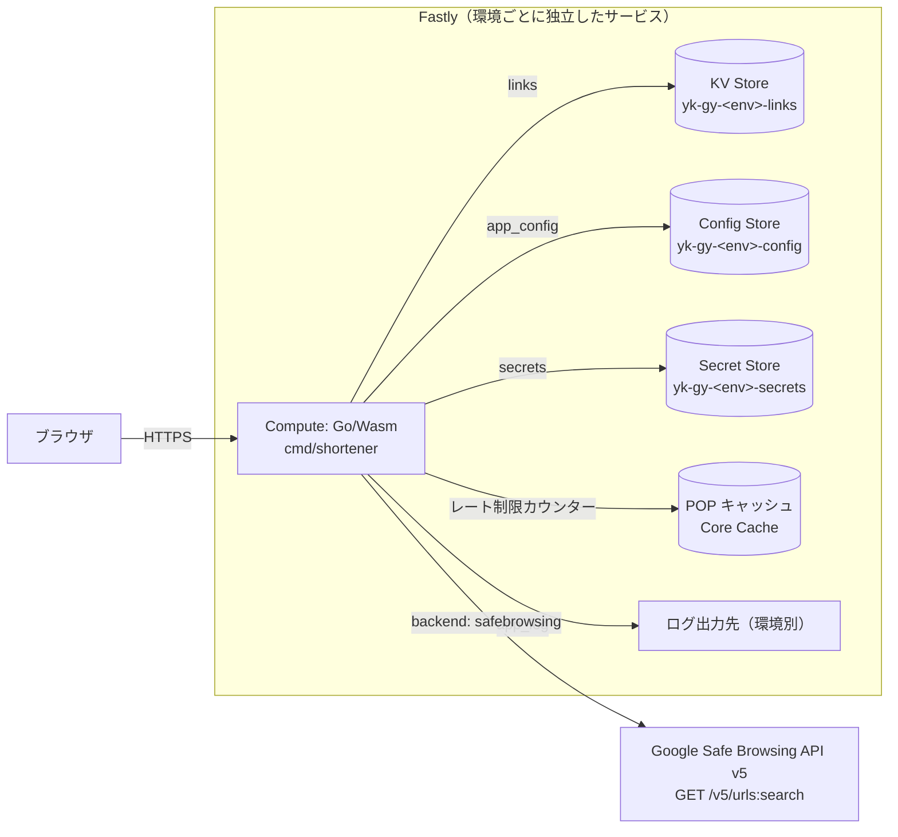
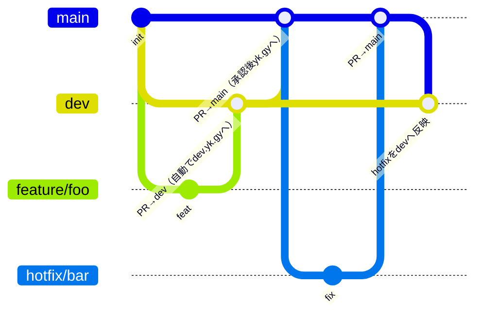

# yk.gy — Fastly Compute + Go の短縮URLサービス

URLを入力すると 7 文字（Base62）の短縮URLを発行し、アクセスされると HTTP 302 で元のURLへリダイレクトする、ログイン不要のシンプルな短縮URLサービスです。Fastly Compute（Go / WebAssembly）上で動作し、データは Fastly KV Store に保存します。ChatGPT や Claude などの AI からも使えます（MCP サーバー・GET API・llms.txt・OpenAPI）。

**現在α版です。** 動作が不安定な場合があり、仕様の変更やサービスの停止、短縮URLやデータの削除を予告なく行う場合があります（画面のフッターにも表示しています）。お問い合わせ：contact@yk.gy

| 環境 | URL | ブランチ | Fastly サービス | デプロイ |
|---|---|---|---|---|
| Production | https://yk.gy | `main` | `yk-gy-production`（本番専用） | GitHub Actions・**明示的な承認後のみ** |
| Development | https://dev.yk.gy | `dev` | `yk-gy-development`（開発専用） | `dev` への push / merge 後、CI 成功時に自動 |
| Local | http://localhost:7676 | `feature/*`, `dev` | なし（Viceroy） | `fastly compute serve` |

本番（yk.gy）以外の環境は、すべての応答に `X-Robots-Tag: noindex, nofollow` を付けて検索エンジンに載らないようにしています。robots.txt はクロールを許可したままにしています（クロールを禁止すると、この指示自体を読めなくなるため）。

> [!IMPORTANT]
> **Google Safe Browsing API は非商用用途向けです。** Google の規約では、別途契約がない限り Safe Browsing API を商用目的で使用できません。商用で運用する場合は [Web Risk API](https://cloud.google.com/web-risk) への切り替えを検討してください（`internal/safebrowsing` のクライアントを差し替えるだけで対応できる構成です）。また、Google は urls:search に送信された URL を自社サービスの改善に利用することがあります。

---

## 目次

1. [アーキテクチャ](#1-アーキテクチャ)
2. [クイックスタート（ローカル）](#2-クイックスタートローカル)
3. [初期設定（GitHub と Fastly）](#3-初期設定github-と-fastly)
4. [ブランチ運用ルール](#4-ブランチ運用ルール)
5. [CI/CD の仕組み](#5-cicd-の仕組み)
6. [本番デプロイの承認手順](#6-本番デプロイの承認手順)
7. [ロールバック](#7-ロールバック)
8. [障害時の対応](#8-障害時の対応)
9. [環境ごとのテスト方法](#9-環境ごとのテスト方法)
10. [セキュリティ設計](#10-セキュリティ設計)
    - [AI から使う（ChatGPT / Claude / MCP / API）](#ai-から使うchatgpt--claude--mcp--api)
    - [セキュリティチェックの結果と残っているリスク](#セキュリティチェックの結果と残っているリスク)
11. [リファレンス（API・設定値・ファイル構成）](#11-リファレンス)
12. [コストと Fastly の無料枠](#12-コストと-fastly-の無料枠)

---

## 1. アーキテクチャ



### リクエストの流れ

| パス | 処理 |
|---|---|
| `GET /` | 埋め込み済みの 1 ページ UI（`web/`）を返す |
| `POST /api/shorten` | ① Content-Type / Origin を確認 → ② レート制限（POP キャッシュ） → ③ URL 検証・正規化 → ④ **同じ URL が登録済みなら既存のコードを返して終了**（Safe Browsing も書き込みもしない） → ⑤ **Safe Browsing で必ず検査（障害時は拒否＝Fail Closed）** → ⑥ 暗号学的乱数で 7 文字コードを生成 → ⑦ KV Store に **条件付き書き込み（add モード：既存キーは上書き不可）**。衝突したらコードを再生成（最大 5 回） → ⑧ URL → コードの索引を書き込む |
| `GET /{7文字}` | KV Store を参照して **HTTP 302**。POP 単位の Simple Cache で読み取りを高速化（TTL は環境別。存在しないコードはキャッシュしない） |
| `GET /api/shorten?url=…` | AI・プログラム向けの発行 API（GET）。処理は POST と同じで、同じ URL なら既存のコードを返す。他サイトに埋め込まれた読み込み（`Sec-Fetch-Site: cross-site`）は拒否 |
| `POST /mcp` | リモート MCP サーバー（ツール `shorten_url`、認証なし、ステートレス）。処理は POST / GET と同じ |
| `GET /llms.txt` / `GET /openapi.json` | AI 向けの使い方（[llms.txt](https://llmstxt.org/)）と OpenAPI 3.1 の定義 |
| `GET /healthz` | 稼働状況（環境名、コミット SHA、Fastly バージョン、各ストアの接続）。`?deep=1` を付けると Safe Browsing への接続と API キーも検査する（書き込みなし。失敗時は `error: http_status_403_SERVICE_DISABLED` のような理由の分類だけを返す） |

### 環境の切り替え方

Go のコードは全環境で共通です。コードが参照するのは **論理名**だけで、論理名にどの実体をつなぐかを Fastly 側（サービスごとの Resource Link）で切り替えます。

| 論理名（コード内） | 種類 | Production | Development | Local（fastly.toml） |
|---|---|---|---|---|
| `links` | KV Store | `yk-gy-production-links` | `yk-gy-development-links` | `test/data/local_kv.json` |
| `app_config` | Config Store | `yk-gy-production-config` | `yk-gy-development-config` | `[local_server.config_stores]` |
| `secrets` | Secret Store | `yk-gy-production-secrets` | `yk-gy-development-secrets` | 環境変数 `SAFE_BROWSING_API_KEY`（任意） |
| `safebrowsing` | Backend | safebrowsing.googleapis.com | 同左 | 同左（live モード時のみ） |
| `app_log` | ログ出力先 | 本番用エンドポイント | 開発用エンドポイント | ターミナルに出力 |
| （キャッシュキー `yk-gy:ratelimit:v1:`） | Core Cache（レート制限） | サービス・POP ごとに独立 | サービス・POP ごとに独立 | Viceroy が読み出しに未対応のため制限なし（警告ログを出す） |

キャッシュ（Simple Cache）もサービス単位で分かれているため、環境間でキャッシュが共有されることはありません。

**本番データを守る仕組み**

- 本番 KV Store にリンクされているのは本番サービスだけです。開発サービスやローカルからは、物理的に参照できません。
- ローカル（`fastly compute serve`）は `fastly.toml` の `[local_server]` に定義したローカルデータだけを使います。Fastly の認証情報も不要です。
- `fastly.toml` の `service_id` は **空** にしています。そのため、うっかり `fastly compute deploy` を実行しても既存サービスには向きません。デプロイは必ず `--service-id` を明示する GitHub Actions 経由で行います。
- Makefile には本番デプロイのターゲットを置いていません。`make deploy-prod` は手順を表示するだけです。また、Makefile とスクリプトは環境変数 `FASTLY_SERVICE_ID` を引き継がないようにしています。
- GitHub の Environment ごとに別々の API トークンを使います。トークンは対象サービスだけに権限を絞って発行します。

### データとアプリのロールバックは別物

- **アプリ**：Fastly のサービスバージョン（パッケージと設定）を再アクティブ化して戻します（[7. ロールバック](#7-ロールバック)）。
- **データ**：KV Store はサービスバージョンに含まれないため、ロールバックしても**既存の短縮リンクは消えません**。リンクと索引は追記専用（add モード）で、アプリには上書きや削除をするコードはありません（α版のため、運営者が手作業でデータを削除する場合はあります）。

---

## 2. クイックスタート（ローカル）

### 必要なもの

| ツール | バージョン | 確認コマンド |
|---|---|---|
| Go | `go.mod` の `toolchain`（現在は go1.26.5）。古い Go でも自動で取得されます | `go version` |
| Fastly CLI | v17 以降（CI は 17.2.0 に固定） | `fastly version` |
| GNU Make / curl / jq | 任意のバージョン | |

```bash
brew install go fastly/tap/fastly jq
```

### 起動

```bash
git clone https://github.com/ykyuki/yk.gy.git
```

```bash
cd yk.gy && git switch dev
```

```bash
fastly compute serve
```

ブラウザで http://localhost:7676 を開きます。初回は Viceroy（ローカルランタイム）のダウンロードとビルドに少し時間がかかります。

- Fastly アカウント、API トークン、Safe Browsing のキーは**いずれも不要**です。
- Safe Browsing は **モック**で動作します（下表）。
- KV Store は `test/data/local_kv.json` のテストデータから毎回起動します。発行したリンクはサーバーを再起動すると消えます。

`make dev` でも起動できます（ファイル変更時に自動で再ビルドします）。

**ローカル（Viceroy 0.22）の制約**：Viceroy は、Go SDK から Core Cache / Simple Cache の値を読み出す操作に対応していません（`operation not supported`）。そのためローカルでは次のようになります。動作確認は Development 環境で行います。
- レート制限はかからず、リクエストごとに `ratelimit_local_unsupported` の警告ログを出します。ローカルかどうかは `FASTLY_HOSTNAME == "localhost"` で判定するので、Fastly 上で制限が外れることはありません。
- リダイレクト時の KV 読み取りキャッシュは効かず、毎回 KV を直接読みます（動作への影響はありません）。

### ローカルの Safe Browsing モック

| 入力URL | 結果 |
|---|---|
| `http://testsafebrowsing.appspot.com/s/malware.html` | 422（MALWARE） |
| `http://testsafebrowsing.appspot.com/s/phishing.html` | 422（SOCIAL_ENGINEERING） |
| `https://malware.example.com/…` / `https://phishing.example.com/…` | 422 |
| `https://sb-unavailable.example.com/` | 503（API 障害を再現：Fail Closed の確認用） |
| それ以外 | 安全と判定 |

**モックはローカル専用です。** コードは `FASTLY_HOSTNAME == "localhost"` のとき（Viceroy 上で実行しているときだけ成り立つ条件）に限り、`safebrowsing_mode = "mock"` を受け付けます。Production / Development のサービスで Config Store に `mock` を設定しても無視され、必ず本物の API を使います（`internal/safebrowsing/mock.go` の `SelectMode` と、そのテストを参照）。

### ローカルで本物の Safe Browsing を使う（任意）

**開発用の API キー**を使い、本物の Google Safe Browsing API に問い合わせて動かせます。本番用のキーは使わないでください。

```bash
make dev-live
```

- 起動時にキーを聞かれます。入力は画面に表示されず、シェル履歴にも残りません。
- `fastly.toml` を書き換える必要はありません。`fastly.toml` からモードと環境名の2行だけを差し替えた `fastly.live.toml` を自動で生成し（`.gitignore` 済み）、`fastly compute serve --env live` で起動します。
- キーはローカルの Secret Store（環境変数 `SAFE_BROWSING_API_KEY`）にだけ渡されます。Fastly 上のストアや本番・開発のデータには一切触れません。
- 環境名は `local-live` と表示されます。

起動したら、次のコマンドでキーと接続を確認できます。

```bash
curl -s "http://localhost:7676/healthz?deep=1"
```

| `checks.safebrowsing` の値 | 意味 |
|---|---|
| `ok` | キーが有効で、API に正常に接続できている |
| `error: http_status_400_API_KEY_INVALID` | キーが間違っている |
| `error: http_status_403_SERVICE_DISABLED` | Google Cloud のプロジェクトで Safe Browsing API が有効になっていない |
| `error: http_status_403_API_KEY_SERVICE_BLOCKED` | キーの「API の制限」で Safe Browsing API が許可されていない |
| `error: http_status_400_INVALID_ARGUMENT` | リクエストの形式が拒否されている（ターミナルのログに詳細が出る） |
| `error: request_failed` | ネットワークエラーなどで API に届いていない |

同じ値は Dev・本番の `/healthz?deep=1` でも表示されます。キーや URL は表示されません。

### ローカル用データ

| コード | 内容 |
|---|---|
| `Example` | https://example.com/ への 302 |
| `SmokeT1` | スモークテスト用リンク（全環境に同じキーで作成） |
| `Disabld` | 無効化済みリンク（410） |

---

## 3. 初期設定（GitHub と Fastly）

> [!NOTE]
> 以下は**外部環境を変更する操作**です。本番・開発ともに、実行するのはリポジトリ管理者です。シークレットの値はチャットやコマンドライン引数に書かず、各ツールの「非表示入力」プロンプトで入力してください。

### 3.1 Fastly：認証

```bash
fastly auth login --sso
```

KV Store / Config Store / Secret Store を作成するには、アカウントで各プロダクトが有効になっていて、トークンにそれらを操作する権限が必要です（`fastly kv-store list` が 403 を返す場合は、権限またはプロダクトの有効化を確認してください）。

### 3.2 Fastly：開発・本番サービスとストアの作成

`scripts/fastly-setup.sh` は、1 つの環境に必要なリソースを冪等に作成します。既存のものは変更しません。最初は必ず dry-run で内容を確認してください。

```bash
scripts/fastly-setup.sh development
```

```bash
scripts/fastly-setup.sh development --apply
```

```bash
scripts/fastly-setup.sh production --apply
```

`--apply` を付けると、確認のためドメイン名の入力を求められます。スクリプトは次を行います。

0. **事前確認**：KV / Config / Secret Store の API が使えるかを先に確かめる。403 などで使えなければ、何も変更せずに終了する（サービスだけ作られて残ることはない）
1. サービス `yk-gy-<env>`（Compute / wasm）を作成する
2. ドメイン（`yk.gy` / `dev.yk.gy`）を **Domain Management API**（`fastly domain create`）でサービスに割り当てる。旧来のバージョン単位のドメイン API は廃止されている。TLS 証明書の申し込みなどで「サービス未割り当て」のまま登録済みのドメインは、`fastly domain update` で割り当てる。別のサービスに割り当て済みなら何もせず停止する
3. バックエンド `safebrowsing`（safebrowsing.googleapis.com:443、TLS 検証あり、タイムアウト付き）を作成する
4. KV / Config / Secret Store を作成し、論理名 `links` / `app_config` / `secrets` でリンクする
5. Config Store に設定値を投入する（[11. リファレンス](#11-リファレンス)）。`short_hosts` には、両サービスに付いているすべてのホスト名（初回デプロイ時に `fastly compute deploy` が自動で付ける `*.edgecompute.app` の既定ドメインを含む）を自動で入れる。既定ドメイン経由で自サービスの URL を登録されるのを防ぐためなので、**初回デプロイの後にもう一度 `--apply` を実行**する
6. Secret Store に `safebrowsing_api_key` を登録する（**非表示プロンプト**で入力）
7. スモークテスト用リンク `SmokeT1` を `--add`（上書きなし）で登録する

最後に表示される **Service ID** を控えておきます（3.6 で使います）。

**ログ出力先**は利用するプロバイダ（S3、BigQuery、Datadog など）によって必要なパラメータが異なるため、自動化していません。各サービスに **`app_log`** という名前でエンドポイントを作成してください。本番と開発で出力先を分けます。

```bash
fastly service logging --help
```

**レート制限**：URL 発行 API のレート制限は、Compute に含まれる **Core Cache（POP ごとのキャッシュ）**で回数を数えます。Fastly の Edge Rate Limiting（ERL）は、Rate Counter と Penalty Box の数で別途課金される有償製品（Contact sales）のため使っていません。追加の製品の有効化や契約は不要です。

### 3.3 Google Safe Browsing API キー

1. Google Cloud Console でプロジェクトを作成し、**Safe Browsing API** を有効化します。本番用と開発用でプロジェクト（またはキー）を分けてください。
2. 「認証情報 → API キーを作成」で、**API の制限を Safe Browsing API のみに設定**します。
3. キーは Fastly Secret Store にだけ保存します（3.2 の手順 6）。**GitHub には保存しません**（CI/CD はキーを必要としません）。
4. キーを差し替えるとき：

```bash
scripts/fastly-setup.sh production --apply --rotate-secret
```

### 3.4 Fastly API トークン（GitHub Actions 用）

Fastly 管理画面の Account → API tokens で、**環境ごとに別のトークン**を作成します。

| 用途 | Scope | Service access |
|---|---|---|
| Development デプロイ | global（デプロイ・バージョン操作に必要） | `yk-gy-development` **のみ** |
| Production デプロイ | global | `yk-gy-production` **のみ** |

有効期限を設定し、定期的にローテーションしてください。

### 3.5 DNS と TLS（yk.gy / dev.yk.gy）

DNS は Cloudflare で管理しています。Fastly 側で TLS 証明書を発行してから DNS を向けます。

1. **証明書の発行**（Let's Encrypt）

```bash
fastly tls-subscription create --domain yk.gy --cert-auth lets-encrypt
```

```bash
fastly tls-subscription create --domain dev.yk.gy --cert-auth lets-encrypt
```

2. **ACME チャレンジ用 DNS レコードの確認**

```bash
fastly tls-subscription describe --id <SUBSCRIPTION_ID> --include tls_authorizations --json
```

`Challenges[]` の `RecordName`（例：`_acme-challenge.yk.gy`）に対し、`Values` の CNAME を Cloudflare に登録します。

3. **配信用レコード**（Cloudflare の Proxy は必ず **DNS only（灰色の雲）**にしてください）

| ホスト | 種類 | 値 |
|---|---|---|
| `yk.gy`（apex） | A（複数） | TLS 設定の A レコード値（Fastly 管理画面の TLS → 該当設定の「DNS details」、例：`151.101.x.x` を 4 つ） |
| `dev.yk.gy` | CNAME | TLS 設定の CNAME 値（例：`x.sni.global.fastly.net`） |

4. `fastly tls-subscription list` で状態が `issued` になれば完了です。CAA レコードがある場合は、発行元（`letsencrypt.org` など）を許可してください。

現在は、`yk.gy` と `dev.yk.gy` を1枚でカバーする証明書（発行元 Certainly）が `issued` です。`dev.yk.gy` は CNAME `2d110b.atlas.fastly.net`、`yk.gy` は A レコード4つ（`151.101.{1,65,129,193}.242`）で Fastly に向けています。

### 3.6 GitHub：Environment・Secrets・ブランチ保護

`scripts/github-setup.sh` が次を設定します。

- Environment `development`（`dev` からのみデプロイ可）と `production`（`main` からのみデプロイ可。プランが対応していれば Required reviewer も設定）
- `main` のブランチ保護（PR 必須、必須チェック、force push / 削除の禁止）
- `dev` の保護（PR のマージには CI の3チェックの成功が必須、force push / 削除の禁止。管理者（オーナー）は直接 push も可能で、その場合は `deploy-dev.yml` の中で CI が実行され、失敗すればデプロイされない）

```bash
scripts/github-setup.sh
```

```bash
scripts/github-setup.sh --apply
```

続けて Variables / Secrets を登録します（`gh secret set` は値を非表示で入力させます）。

```bash
gh variable set FASTLY_SERVICE_ID --env development --body "<開発 Service ID>"
```

```bash
gh variable set BASE_URL --env development --body "https://dev.yk.gy"
```

```bash
gh secret set FASTLY_API_TOKEN --env development
```

```bash
gh variable set FASTLY_SERVICE_ID --env production --body "<本番 Service ID>"
```

```bash
gh variable set BASE_URL --env production --body "https://yk.gy"
```

```bash
gh secret set FASTLY_API_TOKEN --env production
```

| 名前 | 種類 | development | production |
|---|---|---|---|
| `FASTLY_API_TOKEN` | Environment **Secret** | 開発サービス専用トークン | 本番サービス専用トークン |
| `FASTLY_SERVICE_ID` | Environment Variable | 開発 Service ID | 本番 Service ID |
| `BASE_URL` | Environment Variable | `https://dev.yk.gy` | `https://yk.gy` |
| `PROD_DEPLOY_ON_MERGE` | Repository Variable（任意） | — | `true` にすると、main へのマージ時に承認待ちのデプロイを自動で作成（Required reviewers がある場合のみ設定） |

ワークフローは `BASE_URL` が環境に合っているかを検証します。dev 用の値で本番へデプロイしたり、その逆が起きたりしたら、その時点で停止します。

#### 現在の GitHub の設定（リポジトリは public）

| 設定 | 状態 |
|---|---|
| `main` のブランチ保護 | PR 必須、CI の3チェック（Branch policy / Lint & unit tests / Wasm build & integration tests）必須、管理者にも適用、force push・削除の禁止 |
| `dev` のブランチ保護 | PR のマージには CI の3チェックが必須（管理者は直接 push 可）、force push・削除の禁止 |
| `production` Environment | **Required reviewers：`ykyuki`**、`main` からのみデプロイ可 |
| `development` Environment | `dev` からのみデプロイ可 |
| `PROD_DEPLOY_ON_MERGE` | `true`（main へのマージで、承認待ちの本番デプロイが作られる） |
| フォークからの PR | 外部の人の PR は、CI の実行前に承認が必要 |
| Secret scanning / Push protection | 有効（秘密情報を含む push を止める） |
| Dependabot alerts / security updates | 有効 |
| Private vulnerability reporting | 有効（脆弱性を非公開で報告してもらえる） |

#### GitHub のプランによる制約と代替策（private に戻した場合）

| 機能 | 利用条件 | 使えない場合の代替策（実装済み） |
|---|---|---|
| Branch protection / Rulesets（private リポジトリ） | GitHub Pro / Team 以上、または public リポジトリ | ① CI の **Main push guard**：PR を経ずに main へ push されたコミットは CI が失敗する。② `deploy-prod.yml` が「main 上にある」「マージ済み PR 由来」「そのコミットの CI が成功」の 3 条件を満たさないコミットのデプロイを拒否する。③ PR の **Branch policy** チェックで、main へのマージ元を `dev` / `hotfix/*` に限定する |
| Environment の Required reviewers（private リポジトリ） | GitHub Pro / Team 以上、または public リポジトリ | `workflow_dispatch` による**手動デプロイ**＋確認フレーズ `deploy-production` の入力を承認とする（既定の動作） |

---

## 4. ブランチ運用ルール



| ブランチ | 役割 | 作成元 | マージ先 | 直接 push |
|---|---|---|---|---|
| `main` | 本番（yk.gy） | — | — | 禁止（PR のみ） |
| `dev` | 開発環境（dev.yk.gy） | `main` | `main`（PR） | 管理者のみ可。原則は PR（CI 成功が必須） |
| `feature/*` | 個別機能 | `dev` | `dev`（PR） | 可 |
| `hotfix/*` | 本番の緊急修正 | `main` | `main`（PR）、その後 `dev` にも反映 | 可 |

### 日常の操作

機能開発の流れは次のとおりです。

```bash
make feature NAME=better-ui
```

```bash
make dev
```

```bash
make check
```

```bash
git add -A && git commit -m "feat: improve UI"
```

```bash
make pr-dev
```

PR の CI が通ったらマージします。マージすると dev.yk.gy へ自動デプロイされます。

```bash
gh pr merge --merge --delete-branch
```

dev ブランチへの切り替え：

```bash
make switch-dev
```

Dev 環境での確認（デプロイ状況と稼働状況）：

```bash
make status
```

リリース PR（dev → main）の作成：

```bash
make pr-main
```

CI 成功後に main へマージします。本番への反映は [6. 本番デプロイの承認手順](#6-本番デプロイの承認手順) で行います。

```bash
gh pr merge <PR番号> --merge
```

### Hotfix

```bash
make hotfix NAME=fix-redirect
```

修正してコミットしたら、main への PR を作成します。

```bash
git push -u origin HEAD && gh pr create --base main --fill
```

マージして本番デプロイしたら、修正を dev にも反映します。

```bash
git switch dev && git pull --ff-only && git merge origin/main && git push origin dev
```

---

## 5. CI/CD の仕組み

| ワークフロー | トリガー | 内容 |
|---|---|---|
| `ci.yml` | `dev` / `main` への PR、`main` への push、（`deploy-dev.yml` から呼び出し） | Branch policy → Lint & unit tests → Wasm build & integration tests → 成果物 `package-<sha>` を保存 |
| `deploy-dev.yml` | `dev` への push / merge（手動の再実行も可） | CI（同じ commit）→ 成果物を検証 → 開発サービスへデプロイ → ヘルスチェック・スモークテスト → リリースタグ付与（失敗時は直前のバージョンへ自動で戻す） |
| `deploy-prod.yml` | 手動（`workflow_dispatch`）、または承認制での main への push | CI 成功・PR 由来であることを確認 → `production` Environment（承認）→ CI 成果物をそのままデプロイ → 読み取り専用のスモークテスト → リリースタグ付与 |
| `rollback.yml` | 手動 | Fastly の過去バージョンを再アクティブ化 → ヘルスチェック → 履歴タグを記録 |

### CI の各ステップ（`ci.yml`）

1. チェックアウト
2. Go のセットアップ（`go-version-file: go.mod`：バージョンは go.mod の `toolchain` に一本化）
3. `go mod download` / `go mod verify` / `go mod tidy` の差分チェック
4. `gofmt -l`
5. `go vet`（ネイティブ ＋ `GOOS=wasip1`）
6. `staticcheck`（バージョン固定）
7. `go test -race`（カバレッジ付き）と URL 検証のファジング（20 秒）
8. `govulncheck`（脆弱性チェック）
9. `fastly compute build`（`fastly/compute-actions/build`）
10. Viceroy 上の統合テスト（実際の KV Store の add モードで上書きできないことを確認。キャッシュ方式のレート制限のテストは Viceroy が未対応のためスキップ）
11. `fastly compute serve` を起動し、ローカル E2E スモークテスト
12. `pkg/yk-gy.tar.gz`、SHA-256、`build-info.json` を成果物として 90 日間保存

各ジョブの結果は GitHub の Checks に表示されます。どれか 1 つでも失敗すると、デプロイのジョブは実行されません。利用する Action はすべて公式のもの（`actions/*`、`golang/*`、`fastly/compute-actions`）で、**コミット SHA に固定**しています（タグはコメントで併記）。

### Dev 環境への自動デプロイ（`deploy-dev.yml`）

1. `dev` に push / merge すると、CI 全体が同じワークフロー内で実行されます。
2. CI が成功した場合だけ、**同じ実行で作った成果物**をダウンロードし、SHA-256 とコミットが一致するかを検証します。
3. `fastly/compute-actions/deploy` で、`FASTLY_SERVICE_ID`（development）を**明示して**デプロイします。バージョンのコメントは `git:<sha> run:<id> env:development` です。
4. `https://dev.yk.gy/healthz` の commit が新しい SHA に切り替わるまで待ちます（最大 10 分）。そのあと次を確認します。
   - ヘルスチェック（`?deep=1` で Safe Browsing とキーも確認）
   - noindex になっていること（本番では付いていないこと）
   - 1 件だけテスト用URL（`https://example.com/?yk-gy-smoke=<run>`）を発行し、302 を確認
   - 同じ URL を GET API と MCP で送ると、同じコードが返ること
   - llms.txt・openapi.json・MCP の `tools/list` が応答し、他サイトに埋め込まれた GET は 403 になること
   - 拒否されるべき入力が拒否されること
5. 成功したら、タグ `deployed/development/v<Fastlyバージョン>` を付けて結果を Summary に表示します。失敗したら直前のバージョンを自動で再アクティブ化します。

---

## 6. 本番デプロイの承認手順

本番は**明示的な承認なしには一切デプロイされません**。現在は **方式 B**（main へのマージで承認待ちのデプロイが作られ、`ykyuki` が承認する）で運用しています。方式 A の手動実行も、いつでも使えます。

### 方式 A（既定・すべてのプランで利用可）：手動実行＝承認

1. dev → main の PR を作成し、CI 成功を確認してマージします。
2. main への push で CI が実行され、本番用の成果物が作られます（この時点ではデプロイされません）。
3. 承認者がデプロイを実行します。Actions → **Deploy Production** → Run workflow で `confirm` に `deploy-production` と入力するか、次のコマンドを実行します。

```bash
gh workflow run deploy-prod.yml --ref main -f confirm=deploy-production
```

特定のコミットを指定する場合（main 上にあるものに限ります）：

```bash
gh workflow run deploy-prod.yml --ref main -f confirm=deploy-production -f sha=<commit>
```

### 方式 B（Required reviewers が使えるプラン）

1. `production` Environment に Required reviewers を設定します（`scripts/github-setup.sh` が自動で試みます）。
2. Repository Variable `PROD_DEPLOY_ON_MERGE=true` を設定します。
3. main へのマージで deploy ジョブが **Waiting** になります。Actions 画面の「Review deployments」で承認すると実行されます。

### どちらの方式でも行う検証

- そのコミットが `main` 上にあり、**マージ済み PR 由来**であること
- そのコミットの `ci.yml`（push / main）が **success** であること（実行中なら最大 30 分待つ）
- その CI 実行の成果物（`package-<sha>`）を**再ビルドせずに**デプロイすること（SHA-256 も検証）
- デプロイ後の確認は**読み取り専用**のスモークテストです。本番では URL を発行しません。事前に登録したリンク `SmokeT1` の 302、拒否系の入力、`/healthz?deep=1` だけを確認します。
- 成功したらタグ `deployed/production/v<N>` を付与します（`git tag -l 'deployed/production/*'` でリリース履歴を確認できます）。
- 同じ環境へのデプロイとロールバックは `concurrency` で直列化され、同時には実行されません。

---

## 7. ロールバック

Fastly のサービスバージョンは、アクティブ化した時点で変更できなくなります（パッケージと設定を含む）。ロールバックは、**以前の正常なバージョンを再アクティブ化**する方式です。

- **正常なバージョンの記録**：スモークテストに合格したデプロイだけに `deployed/<env>/v<N>` タグを付けます（タグはコミット SHA を指します）。Fastly のバージョンコメントにも `git:<sha>` を記録しています。
- **実行**：Actions → **Rollback**。もしくは次のコマンドを実行します。

開発環境を、1 つ前の正常なバージョンへ戻す：

```bash
gh workflow run rollback.yml --ref main -f environment=development -f reason="動作確認のため"
```

本番環境を、特定のバージョンへ戻す（確認フレーズが必須で、Required reviewers がある場合は承認待ちになります）：

```bash
gh workflow run rollback.yml --ref main -f environment=production -f confirm=rollback-production -f target_version=12 -f reason="障害対応"
```

戻せるバージョンの一覧（バージョンとコミット）を確認する：

```bash
git fetch --tags && git tag -l 'deployed/production/*' --sort=-v:refname
```

- `target_version` を省略すると、現在アクティブなバージョンより古い、最新の正常なバージョンを自動で選びます。
- ロールバック後はヘルスチェックを行い、そのバージョンのコミットが `/healthz` に反映されたかを確認します。
- **履歴**：Actions の実行履歴、GitHub Deployments（Environment）、`rollback/<env>/<UTC時刻>` タグ（実行者・理由・結果を含む）の 3 か所に残ります。
- **データ**：KV Store はロールバックの対象外です。新しいバージョンで作られたリンクも、ロールバック後もそのまま使えます。

ロールバックしたら、原因を修正して通常のフロー（hotfix など）で再リリースしてください。

---

## 8. 障害時の対応

| 症状 | 確認方法 | 対応 |
|---|---|---|
| 全体が 5xx / 応答なし | `make status`、Fastly ダッシュボード、https://www.fastlystatus.com/ | 直前のデプロイが原因ならロールバック（7 章） |
| 発行が 503 `safety_check_unavailable` | `curl https://yk.gy/healthz?deep=1` | Safe Browsing の障害、キーの失効・クォータ超過。**意図した Fail Closed**です。キーを確認し、必要なら `--rotate-secret` で差し替える |
| 発行が 503 `ratelimit_unavailable` | ログ（`event=ratelimit_error`） | Core Cache の読み書きに失敗している。Fastly の状態を確認し、一時的には Config Store で `ratelimit_on_error=allow` |
| 発行が 503 `storage_unavailable` | ログ（`event=shorten_failed`） | KV Store の状態や Resource Link（`links`）を確認する |
| リダイレクトが 503 | `/healthz` の `kv_store` | 同上 |
| 悪性リンクの通報 | — | KV のエントリを `disabled: true` に更新すると 410 になる（下記）。キャッシュ TTL（本番 1 時間）以内に反映される。すぐに反映したい場合はパージする |
| 誤ったコミットが本番に出た | `deployed/production/*` タグ | ロールバック → hotfix |

悪性リンクを無効化する（データは削除せず、410 を返すようにします）：

```bash
fastly kv-store-entry create --store-id <本番KV ID> --key <CODE> --value '{"url":"<元URL>","created_at":"<元の値>","disabled":true}'
```

ログの確認：`fastly log-tail` はこのサービスでは 404 エラーになり、使えませんでした（2026年11月時点）。ログを調べられるようにするには、各サービスにログ出力先 `app_log` を作成してください（[3.2](#32-fastly開発本番サービスとストアの作成)）。それまでは、Safe Browsing の失敗理由を `/healthz?deep=1` で確認できます（[2. ローカルで本物の Safe Browsing を使う](#ローカルで本物の-safe-browsing-を使う任意) の表を参照）。

無効化したリンクと同じ URL は、新しいコードでも登録できなくなります（410 `disabled_url`）。

---

### ログ（記録する内容と IP アドレスの扱い）

アプリは出来事を1件ずつ JSON で、ログ出力先 `app_log` に送ります。開発環境は Datadog（リージョン US5）に送っています。本番はまだ `app_log` が未設定なので、記録は残りません。

| `event` | 記録するタイミング | 主な項目 |
|---|---|---|
| `page_view` | トップページの表示（GET） | `path` |
| `redirect` | 短縮 URL へのアクセス | `code`、`status`（302 / 404 / 410）、`target_host`（302 のとき） |
| `link_created` | 新しい短縮 URL の発行 | `code`、`target_host` |
| `unsafe_rejected` | Safe Browsing による拒否 | `threats` |
| `rate_limited` | レート制限による拒否 | `rate_key`（IPv6 は /64） |
| `safebrowsing_unavailable` / `deep_health_safebrowsing_error` / `ratelimit_error` / `shorten_failed` / `resolve_failed` | 障害 | `error` |

**すべてのログ**に、`env`・`service_version`・`country`（Fastly のジオロケーションで判定した国コード）・`ip`（**完全な IP アドレス**）が付きます。

- **EU 27か国・EEA 3か国（アイスランド・リヒテンシュタイン・ノルウェー）・英国からのアクセスでは、`ip` を `null` にします**（GDPR / UK GDPR への配慮）。国を判定できなかった場合も `null` にします（`internal/privacy`）。
- CSS・JS などの静的ファイル、HEAD リクエスト、`/healthz` は記録しません。
- ローカル（`fastly compute serve`）では、`fastly.toml` の `[local_server.geolocation]` で `127.0.0.1` を日本（JP）として扱います。
- 収集する情報・目的・預け先・保存期間は、プライバシーポリシー（`/privacy`、`web/privacy.html`）で公開しています。ログの保存期間は **15日** と定めているので、Datadog のインデックスの保存期間（Logs → Configuration → Indexes の Retention）を15日に設定してください。ポリシーと実際の設定がずれないよう注意します。

## 9. 環境ごとのテスト方法

| 対象 | コマンド | 内容 |
|---|---|---|
| ユニットテスト | `make test`（`go test ./...`） | 検証・コード生成・重複判定・Safe Browsing クライアント（protobuf の応答とエラー）・ハンドラ・GET API・MCP のプロトコル・レート制限・設定 |
| 競合検出とカバレッジ | `make test-race` | `-race` とカバレッジ |
| ファジング | `make fuzz` | URL 検証の堅牢性と冪等性 |
| 統合テスト（Viceroy） | `make test-integration` | 実際の KV Store の add モード（上書き不可）。キャッシュ方式のレート制限は Viceroy が読み出し未対応のためスキップされ、Development のスモークテストで検証する |
| 静的解析 | `make lint` | gofmt / vet（wasip1 を含む）/ staticcheck / govulncheck |
| CI 相当を一括実行 | `make check` | lint ＋ test ＋ integration ＋ build |
| ローカル E2E | `make serve` を起動した状態で `make smoke` | 発行 → 302、同じ URL の重複判定（GET API・MCP）、AI 向けの入口、noindex、悪性URLの拒否、Fail Closed、再帰登録・プライベート IP の拒否 |
| ローカル（本物の Safe Browsing） | `make dev-live` | 開発用キーを非表示で入力して起動し、`/healthz?deep=1` でキーを確認 |
| Development | 自動（`deploy-dev.yml`）、または `scripts/smoke-test.sh https://dev.yk.gy --env development --deep --write` | 実際の Safe Browsing と KV（開発データ）を使った発行・リダイレクト |
| Production | 自動（`deploy-prod.yml`）、または `scripts/smoke-test.sh https://yk.gy --env production --deep` | **読み取り専用**。URL は発行しない |

手動での確認例：

```bash
curl -si -H 'Content-Type: application/json' -d '{"url":"https://www.fastly.com/"}' http://127.0.0.1:7676/api/shorten
```

```bash
curl -si http://127.0.0.1:7676/Example
```

---

## 10. セキュリティ設計

### AI から使う（ChatGPT / Claude / MCP / API）

ChatGPT や Claude に「このURLを yk.gy で短縮して」と頼めば、短縮 URL を作れるようにしています。どの方法も**認証や API キーは不要**で、**同じ URL には常に同じ短縮 URL** を返します（何度呼ばれてもデータは増えません）。

| 使い方 | 向いているもの | 設定 |
|---|---|---|
| **MCP コネクター**（`https://yk.gy/mcp`） | ChatGPT（Business / Enterprise / Edu / Pro の「カスタム MCP サーバー」）、Claude（カスタムコネクター）、MCP 対応のエージェント | AI の設定画面で URL を追加する。ツール名は `shorten_url` |
| **カスタム GPT の Actions**（`https://yk.gy/openapi.json`） | ChatGPT のカスタム GPT | GPT の「アクション」でスキーマの URL を読み込み、認証は「なし」 |
| **GET API**（`https://yk.gy/api/shorten?url=<URLエンコードしたURL>`） | ブラウジングできる AI、curl、Claude Code などのコーディングエージェント、スクリプト | 不要 |
| **llms.txt**（`https://yk.gy/llms.txt`） | 使い方を AI に読ませる | 不要 |

```bash
curl "https://yk.gy/api/shorten?url=https%3A%2F%2Fexample.com%2Flong%2Fpage&format=text"
```

**各 AI の制約（2026年11月時点の公式ドキュメント）**
- **Claude のウェブ取得機能**は、会話に出てきた URL しか開けません。AI が自分で API の URL を組み立てて開くことはできないため、Claude から使うときは **MCP コネクター**を追加してください。
- **ChatGPT** で確実に使えるのは、MCP コネクター（Business / Enterprise / Edu、Pro）とカスタム GPT の Actions です。通常のチャットのブラウジングで API の URL を開けるかは、公式には書かれていません。
- MCP は、最新のステートレス仕様（2026-07-28：`server/discover` と各リクエストの `_meta`）と、従来の接続手順（`initialize` / `ping`。2025-11-25・2025-06-18・2025-03-26）の両方に対応しています。セッション ID は発行しません。

**悪用対策**
- 作成を伴う GET が他サイトの `` などから呼ばれないよう、ブラウザが付ける `Sec-Fetch-Site` が `cross-site` / `same-site` のリクエストは 403 で拒否します（AI やプログラムはこのヘッダーを送りません）。`HEAD` では何も作成しません。
- robots.txt で、検索エンジンや学習用のクローラーには API を開放せず、ユーザーの指示で動くエージェント（`ChatGPT-User` / `Claude-User` / `Perplexity-User`）にだけ許可しています。API の応答には `X-Robots-Tag: noindex` を付けます。
- GET・POST・MCP のすべてで、同じレート制限と同じ検査（URL 検証、Safe Browsing）を通ります。ChatGPT などのサーバーから来るリクエストは、少数の IP にまとまることがあります。利用者が増えて 429 が増えたら、本番の `ratelimit_per_minute` を上げてください。
- 運営者が無効化した URL（`disabled: true`）は、新しいコードで登録し直すこともできません（410 `disabled_url`）。


| 対策 | 実装 |
|---|---|
| 悪性URLの判定 | Google Safe Browsing API v5 `urls:search`。v5 は protobuf でしか応答しない（`alt=json` は 400 `Unsupported Output Format`）ため、`protowire` で読み取る。脅威の項目が1件でもあれば危険と判定する。新しい URL の登録時に**必ず**検査し、API エラー、200 以外の応答、protobuf 以外の応答、壊れた応答、キー未設定のいずれでも登録を拒否（Fail Closed） |
| API キーの管理 | Fastly Secret Store（`secrets/safebrowsing_api_key`）。URL ではなく `X-Goog-Api-Key` ヘッダーで送信し、ログに残らないようにする。コードや GitHub には保存しない |
| 許可するスキーム | `http` / `https` のみ（`javascript:`、`data:`、`file:` などは拒否） |
| 内部宛てURLの拒否 | `localhost`、`*.local` / `.internal` / `.home.arpa` などの内部名、単一ラベルのホスト、プライベート / ループバック / リンクローカル / CGNAT / 予約済み IP（IPv4・IPv6、IPv4-mapped、`2130706433` や `0x7f.1` のような 10 進・16 進・8 進表記も含む）、`nip.io` 系のワイルドカード DNS |
| 再帰登録の防止 | `yk.gy` とそのサブドメイン（`dev.yk.gy` を含む）、両サービスの `*.edgecompute.app` 既定ドメイン、リクエストの Host、他の主要な短縮サービス（bit.ly、t.co など）を拒否 |
| その他の入力検証 | 2048 文字以内、制御文字・空白は拒否、ユーザー情報付きURL（`https://google.com@evil/`）は拒否、ポート番号を検証、IDN は punycode に正規化 |
| レート制限 | Core Cache を使ったスライディングウィンドウ（直前の1分を重み付けして加算）。クライアント IP（IPv6 は /64 単位）ごと、POP ごとに 1 分あたり N 回（本番 10、開発 20）。超えると 5 分間 Penalty Box に入れる。キャッシュのエラー時も既定では拒否する。1回のリクエストを、**書き換えない番号付きの印**（`rl:<IP>:<分>:<n>`、キャッシュのトランザクションで作成）として記録し、回数は二分探索で数える。値を上書きする方式は、上書きしても書き込んだサーバーに古い値が残り続け、POP 内のサーバーごとに回数がばらけて上限に届かなかったため採用していない（dev で実測）。dev.yk.gy では、18台のサーバーにまたがっても21回目で 429、約300秒で解除されることを確認済み。有償の Edge Rate Limiting は使っていない |
| 重複登録の防止 | 正規化した URL の SHA-256 をキーにした索引（`u:<hash>`、add モード）で、同じ URL には既存のコードを返す。繰り返しや自動の呼び出しでも、データも Safe Browsing の呼び出しも増えない |
| 検索エンジン | 本番以外は全応答に `X-Robots-Tag: noindex, nofollow`。API は全環境で noindex |
| CSRF / クロスサイトからの悪用 | `Content-Type: application/json` を必須にし（他オリジンからはプリフライトが必要になり、そのプリフライトには応答しない）、Origin ヘッダーが付いていれば同一オリジンかを検証 |
| XSS | フロントエンドは `textContent` / `value` だけで描画し（`innerHTML` は使わない）、エラーページは HTML エスケープ、JSON は `<>&` をエスケープ。厳格な CSP（`script-src 'self'`）、`X-Frame-Options: DENY`、`nosniff`、`Referrer-Policy: no-referrer`、HSTS |
| コードの推測困難性 | `crypto/rand` を使い、リジェクションサンプリングで偏りのない 62^7（約 3.5 兆）通り |
| 上書きの防止 | KV の `InsertModeAdd`。既存キーへの書き込みは `ErrPreconditionFailed` となり、別のコードで再試行する |
| 保存済みレコードの改ざん対策 | リダイレクト時にも http(s) かどうかを再確認する |

SSRF について：このサービスは登録されたURLに**自分からアクセスしません**（リダイレクトするだけ）。そのため、DNS リバインディングを含む SSRF の経路はありません。

### セキュリティチェックの結果と残っているリスク

2026年11月に、独立したコードレビュー、URL 検証の抜け道テスト（約40パターン）、dev.yk.gy への実地テストを行いました。XSS、ヘッダー注入、既存リンクの上書き、秘密情報の漏えい、CI/CD の乗っ取りにつながる問題は見つかりませんでした。悪用や料金の吊り上げにつながる点は、次のとおりです。

| # | 深刻度 | 内容 | 状態 |
|---|---|---|---|
| 1 | 高 | Safe Browsing の検査は登録時の1回だけ。登録後に中身を差し替えたサイト、未登録の新しいドメイン、別サイトの転送機能や未登録の短縮サービスを経由した URL は検査できない。止める手段は KV の手作業での無効化だけ | **未対応**。案：リダイレクトのたびに判定をキャッシュ付きで再確認する、通報窓口と即時無効化のスクリプト、本番のキャッシュ TTL の短縮 |
| 2 | 中〜高 | 大量の IP（IPv6 の /48 など）からの登録で Google API の割り当てを使い切られ、全員が発行できなくなる。データの書き込みも増える | **一部対応**（同じ URL は再検査・再書き込みしない）。案：/56・/48 単位の制限、POP 全体の上限 |
| 3 | 中 | `/healthz?deep=1` を誰でも呼べ、他サイトに埋め込まれると訪問者のブラウザから Safe Browsing を呼ばれる | **未対応**。案：秘密トークンを必須にする |
| 4 | 中 | 存在しないコードへの GET に制限がなく、1回ごとに KV の読み取りが発生する（料金の吊り上げ） | **未対応**。案：404 にも IP ごとの制限 |
| 5 | 中 | `*.edgecompute.app` の既定ドメインで再帰防止をすり抜けられる | **対応済み**（`short_hosts` に自動追加） |
| 6 | 低 | `http://[::127.0.0.1]/`（廃止済みの IPv4 互換 IPv6 表記）が通る | **未対応**。案：`::/96` を拒否 |
| 7 | 低 | 見た目がそっくりな別ドメイン（例：キリル文字の `аpple.com`）を登録できる | 未対応（利便性とのトレードオフ） |
| 8 | 低 | dev.yk.gy も、本物の Safe Browsing を使う「公開された2つ目の短縮サービス」になっている | 未対応（Basic 認証などで保護する案） |
| 9 | 低 | CI/CD の堅牢化（デプロイジョブが書き込み権限付きの認証情報を保持、`deployed/*` タグを偽造でき、ロールバック先を誘導できる） | **未対応**。案：`persist-credentials: false`、タグの保護ルール |

---

## 11. リファレンス

### API

`POST /api/shorten`

```json
{"url": "https://example.com/very/long/path"}
```

成功時（新規は 201、同じ URL が登録済みなら 200 で `created: false`）：

```json
{"code": "aZ3k9Qx", "short_url": "https://yk.gy/aZ3k9Qx", "url": "https://example.com/very/long/path", "created": true}
```

`GET /api/shorten?url=<URLエンコードしたURL>` も同じ応答を返します。`&format=text` を付けると、短縮 URL だけをテキストで返します（エラーは `error: <code>: <message>`）。

`POST /mcp`：MCP（Streamable HTTP、JSON 応答のみ）。ツール `shorten_url`（引数 `url`）。結果は `content[0].text` が短縮 URL、`structuredContent` が上の JSON と同じ内容です。拒否された場合は `isError: true` で、理由のコードを本文に含みます。

失敗時：`{"error": {"code": "...", "message": "日本語メッセージ"}}`

| HTTP | code |
|---|---|
| 400 | `empty`, `missing_url`, `too_long`, `invalid_url`, `unsupported_scheme`, `userinfo_not_allowed`, `private_host`, `recursive`, `blocked_host`, `invalid_port`, `invalid_host`, `invalid_characters`, `bad_json` |
| 403 | `forbidden_origin`（POST の Origin が他サイト）, `cross_site_request`（GET が他サイトに埋め込まれた） |
| 405 | `method_not_allowed` |
| 410 | `disabled_url`（運営者が無効化した URL） |
| 413 / 415 | `too_large` / `unsupported_media_type` |
| 422 | `unsafe_url`（Safe Browsing が危険と判定） |
| 429 | `rate_limited`（`Retry-After` ヘッダー付き） |
| 503 | `safety_check_unavailable`, `ratelimit_unavailable`, `storage_unavailable` |

### Config Store（`app_config`）のキー

| キー | 既定値 | production | development | local |
|---|---|---|---|---|
| `environment` | `unknown` | `production` | `development` | `local` |
| `base_url` | Host から推測 | `https://yk.gy` | `https://dev.yk.gy` | `http://localhost:7676` |
| `short_hosts` | `yk.gy` | `yk.gy,dev.yk.gy,www.yk.gy` ＋両サービスの既定ドメイン（セットアップスクリプトが自動で設定） | 同左 | `yk.gy,dev.yk.gy,localhost,127.0.0.1` |
| `blocked_hosts` | 主要な短縮サービス | 既定 | 既定 | 既定 |
| `safebrowsing_mode` | `live` | `live` | `live` | `mock`（**ローカル以外では無視**） |
| `ratelimit_per_minute` | 10 | 10 | 20 | 30 |
| `ratelimit_penalty_seconds` | 300 | 300 | 300 | 60 |
| `ratelimit_on_error` | `deny` | `deny` | `deny` | `deny` |
| `redirect_cache_ttl_seconds` | 0 | 3600 | 60 | 0 |

不正な値は既定値に戻ります（安全側に倒します）。

### KV Store のレコード

キーが `u:<URL の SHA-256（base64url）>` のエントリは、同じ URL に同じコードを返すための索引です（値はコード。上書きしない）。
キーが 7 文字のコードのエントリはリンク本体で、値は次の形式です。

```json
{"url":"https://...","created_at":"2026-11-27T00:00:00Z","disabled":false}
```

### ファイル構成

```text
.
├── .github/workflows/
│   ├── ci.yml            # CI（PR / main push / 再利用ワークフロー）
│   ├── deploy-dev.yml    # dev → dev.yk.gy 自動デプロイ
│   ├── deploy-prod.yml   # main → yk.gy 承認制デプロイ
│   └── rollback.yml      # バージョン再アクティブ化によるロールバック
├── cmd/shortener/        # Compute のエントリポイント（Fastly リソースとの接続）
├── internal/
│   ├── config/           # 論理リソース名と Config Store の読み込み
│   ├── handler/          # HTTP ルーティング、API、302、セキュリティヘッダー（ai.go：GET API・llms.txt・OpenAPI・MCP の接続）
│   ├── mcp/              # ステートレスなリモート MCP サーバー（2026-07-28 と initialize 方式の両対応）
│   ├── ratelimit/        # Core Cache によるレート制限（スライディングウィンドウ＋Penalty Box）
│   ├── safebrowsing/     # Safe Browsing v5 クライアント（protobuf の読み取り）とローカル専用モック
│   ├── shortener/        # コード生成と登録フロー
│   ├── storage/          # KV Store（条件付き書き込み、URL → コードの索引、キャッシュ）
│   └── validation/       # URL 検証と正規化
├── web/                  # index.html / style.css / app.js / robots.txt / favicon.svg（Wasm に埋め込み）
├── test/
│   ├── data/local_kv.json        # ローカル KV 用データ
│   └── integration/              # Viceroy 上の統合テスト
├── scripts/
│   ├── fastly-setup.sh   # 環境別の Fastly リソース作成（dry-run が既定）
│   ├── github-setup.sh   # Environment とブランチ保護（dry-run が既定）
│   ├── smoke-test.sh     # ヘルスチェックとスモークテスト
│   ├── release.sh        # バージョンとリリースタグのヘルパー
│   └── status.sh         # make status
├── fastly.toml           # Compute のマニフェストとローカルサーバー設定（make dev-live 用の fastly.live.toml はここから自動生成）
├── go.mod / go.sum
└── Makefile
```

---

## 12. コストと Fastly の無料枠

2026年11月時点の Fastly 公式ページによると、無料枠（月）は Compute リクエスト1,000万、vCPU 1億ミリ秒、転送量100GB です。KV Store は2〜5個（ページによって記載が異なる）、書き込み（Class A）10万〜25万回、読み取り（Class B）100万〜500万回。シークレットは合計10個、Config Store は5個、Certainly の証明書は5件まで無料です。

| 項目 | このサービスでの使用量 |
|---|---|
| KV Store | 2個（本番・開発） |
| KV の書き込み | 新しい URL の登録1件につき2回（リンクと索引）。同じ URL の再登録では書き込まない |
| KV の読み取り | リダイレクト時。本番は POP ごとに1時間キャッシュする。存在しないコードへのアクセスは毎回読み取る（セキュリティチェック #4） |
| シークレット | 2個（各環境の Safe Browsing キー） |
| レート制限 | Compute に含まれる Core Cache を使う。Edge Rate Limiting は Rate Counter と Penalty Box の数で別途課金される有償製品（Contact sales）のため使っていない |

- **無料枠を超えると止まらず、登録済みのカードに月末に自動で請求されます。** 利用額の上限設定はありません。
- 無料アカウントは、利用規約上「機能を試すため」のもので、予告なく停止される場合があります。
- Google Safe Browsing API は非商用用途向けです（冒頭の注意を参照）。

